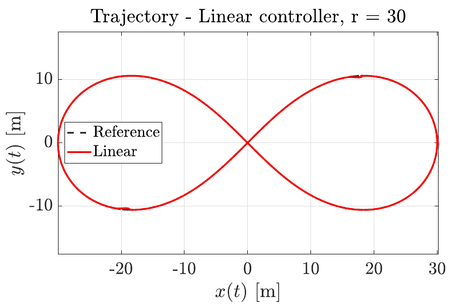
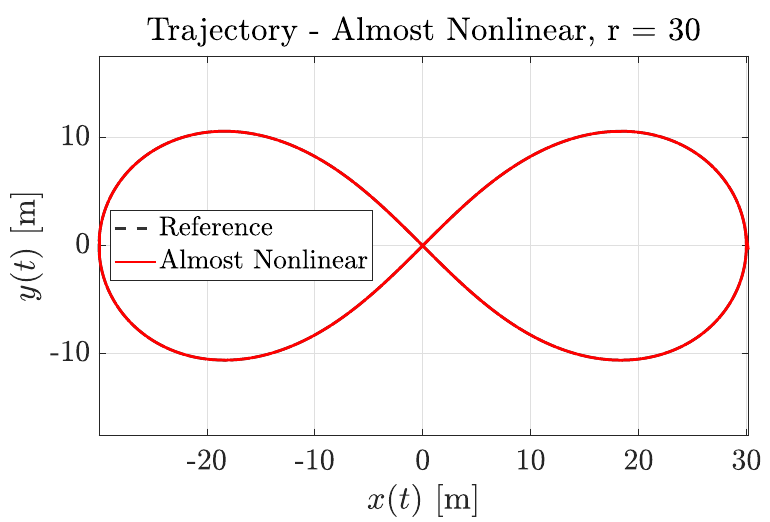
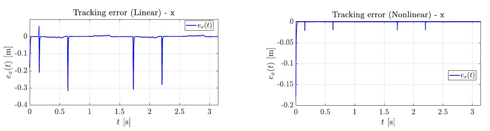

# Unicycle Motion Planning, Control & Odometry

*Field and Service Robotics · University of Naples Federico II · 2024–2025*

## Overview

A simulation study of a unicycle mobile robot, from generating a feasible point-to-point trajectory to tracking a figure-eight path and reaching a target pose with odometric feedback.

## Implementation

- The planner uses a Cartesian cubic path and a cubic time law. The motion duration was rescaled to meet linear and angular velocity limits while preserving the path geometry.
- An input–output linearization controller was built around a virtual point ahead of the robot. The comparison covered four offsets from the robot center.
- The comparison evaluated approximate linearization and almost-nonlinear control on Bernoulli lemniscates with scale parameters **3 and 30**. Each comparison used the same initial pose for both controllers.
- A polar pose regulator was combined with second-order Runge–Kutta odometry to close the loop on the estimated pose.

## Tools

MATLAB, Simulink, and the Robotics System Toolbox unicycle model.

## Run

Set MATLAB's current folder to the relevant task folder and open the corresponding script below. Keep each script alongside its Simulink models. In Task 3, set `caso = 1` for scale 3 or `caso = 2` for scale 30. Each run samples a new initial pose and generates the reference data it needs.

## Key results

- Time scaling brought the documented trajectory within the **0.5 m/s** linear and **2 rad/s** angular speed limits.
- The virtual-point experiments showed a trade-off between tracking the robot center and tracking its heading as the offset changed.
- The almost-nonlinear controller followed the reference more closely in the documented comparisons, particularly on the larger lemniscate.
- The polar regulator brought the simulated robot to the target position. A repeat run reached a position error below 0.02 mm, with about 0.10 rad of heading error at the end of the 20-second simulation. The odometric and simulated paths closely agreed under ideal, noise-free inputs.

## Lemniscate comparison

The dashed line is the reference trajectory. The position-error plots below make the difference between the two controllers easier to see at scale 30.

| Approximate linearization | Almost-nonlinear control |
| --- | --- |
|  |  |

## Project files

- [Technical report](unicycle-motion-planning-control-and-odometry.pdf)
- [Task 1 · Cubic path planning](Task%201/es_1_main.m)
- [Task 2 · Input–output linearization](Task%202/es_2_main.m) · [Simulink model](Task%202/modello_es_2.slx)
- [Task 3 · Lemniscate tracking comparison](Task%203/es_3_main_definitivo_conPlot.m) · [Linear controller model](Task%203/es_3_model_linear.slx) · [Almost-nonlinear controller model](Task%203/es_3_model_almost_nonlinear.slx)
- [Task 4 · Pose regulation with odometry](Task%204/es_4_main.m) · [Simulink model](Task%204/es_4_model.slx)
